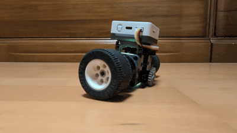
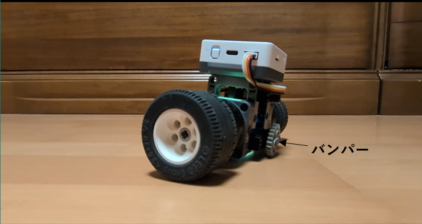
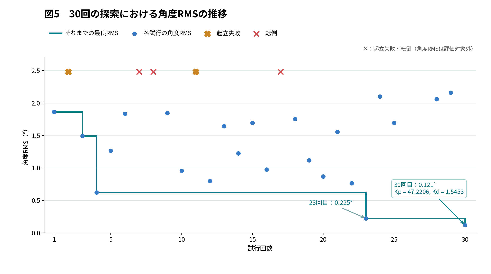
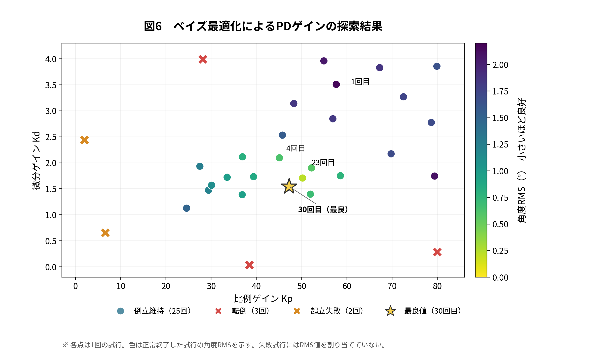
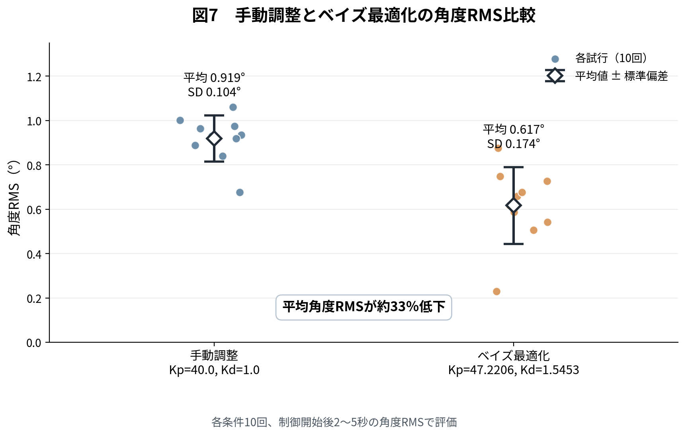

# M5Stack Core2 二輪倒立振子：自動起立とベイズ最適化によるPDゲイン探索

M5Stack Core2とRoller485 Lite×2を用いた二輪倒立振子について、**ジグからの自動起立**と**ベイズ最適化によるPDゲインの探索**を試した実験記録です。PCのPythonが次のゲインを提案し、Core2のMicroPythonが実機を制御して結果を返します。探索30回と、手動ゲイン・最適化ゲイン各10回の比較試験の実測CSVを公開します。

> **実機を自動的に倒立状態に移行させる仕組み**が、ゲイン探索を繰り返すための鍵でした。AIが100Hzの姿勢制御を直接実行するのではなく、PC側でPDゲインを選び、Core2側がPD制御を実行します。





## 実験装置

| 項目 | 内容 |
|---|---|
| 本体 | M5Stack Core2、M5GO Bottom2 |
| 駆動 | Roller485 Lite × 2（I2C `0x64`, `0x65`） |
| 姿勢計測 | Core2内蔵IMU（加速度・ジャイロ） |
| Core2側 | UIFlow2対応MicroPython、PD制御100Hz |
| PC側 | Python 3、ベイズ最適化（ガウス過程回帰＋Expected Improvement） |
| 通信 | 同一Wi-Fiネットワーク、HTTP GET `/gains` / POST `/result`、ポート8000 |
| 初期姿勢 | 垂直でキャリブレーション後、ジグに約5～8°傾けて設置 |

モーターは電流制御モード（mode 3）、指令上限は200。起立・転倒・角度・周期の停止判定を設けています。これらは本装置用の設定で、他機種の安全性を保証するものではありません。

## 実験結果

### 30回の探索（3秒試行）

- 探索範囲：`Kp = 0～80`、`Kd = 0～4`
- 初期6条件、その後24条件をベイズ最適化で選択
- 3秒試行、角度RMSの評価区間は**開始後1～3秒**
- 完走25回、起立失敗2回、転倒3回
- 最良は**30回目**：`Kp = 47.2206`、`Kd = 1.5453`、角度RMS **約0.121°**
- 失敗試行はRMSでなく、別途ペナルティを含む `score` で最適化に反映





### 手動ゲインとの比較（5秒試行、各10回）

| 条件 | Kp | Kd | 正常終了 | 角度RMS平均 | 標本標準偏差 |
|---|---:|---:|---:|---:|---:|
| 手動調整 | 40.0 | 1.0 | 10/10 | 0.919° | 0.104° |
| ベイズ最適化 | 47.2206 | 1.5453 | 10/10 | **0.617°** | 0.174° |

こちらは**開始後2～5秒**の角度RMSで評価しています。平均RMSは約**32.9%低下**しましたが、標準偏差は最適化ゲインの方が大きくなりました。探索中の最良値0.121°と比較試験の平均値は、**試行時間と評価区間が違うため直接比較できません**。また、初期傾斜方向などが完全に一致していないため、厳密な性能差の断定には追加試験が必要です。



## ディレクトリ構成

```text
.
├── README.md
├── requirements.txt
├── LICENSE_NOTE.md
├── core2/
│   ├── core2_pd_bayes_stage1.py    # Core2側：3秒探索
│   ├── core2_main_5sec.py         # Core2側：5秒比較
│   └── core2_auto_stand_10sec.py  # Core2単体：10秒自動起立デモ（Wi-Fi不要）
├── pc/
│   ├── pc_pd_bayes_stage1.py      # 新規30回探索用サーバー
│   ├── pc_pd_bayes_resume.py      # 当時の中断復旧用（汎用再開用ではない）
│   └── pc_fixed_5sec_server.py    # 5秒比較用サーバー（manual / optimized）
├── data/
│   ├── pd_bayes_stage1_results.csv
│   ├── pd_5sec_manual_10_results.csv
│   └── pd_5sec_optimized_10_results.csv
├── analysis/
│   ├── summarize_data.py          # 公開データの集計（標準ライブラリのみ）
│   └── compare_results.py         # 5秒比較の集計
├── figures/                       # 図5～図7（PNG）
└── media/                         # 実機GIF、バンパー注記付き写真
```

## まずはデータを見る（実機不要）

```powershell
py analysis/summarize_data.py
```

`data/` のCSVは**実測データ**です。失敗時の `rms=-1` は無効値で、平均に含めません。`score` は失敗時のペナルティを含む最適化用評価値です。CSVはExcelでも開けます。

## 実機での再実験

### 事前準備

1. PCにPython 3を用意し、`py -m pip install -r requirements.txt` を実行します（ThonnyのLocal Python 3でも可）。
2. Core2にUIFlow2対応MicroPythonを導入し、`M5`、`unit.Roller485Unit` が使用できることを確認します。
3. PCとCore2を同じWi-Fiに接続します。PC側ファイアウォールで必要に応じてTCP 8000を許可します。
4. Core2側のファイルで `WIFI_SSID`、`WIFI_PASSWORD`、`SERVER`（例：`http://192.168.x.x:8000`）を各自の環境に変更します。
5. ジグの位置、モーター回転方向、I2Cアドレス、緊急停止を事前確認します。

### 30回の新規探索

PCで次を実行します。

```powershell
py pc/pc_pd_bayes_stage1.py
```

`pc/` に `pd_bayes_stage1_results.csv` が既にある場合、上書き防止のためサーバーは起動しません。公開用の `data/` には手を加えず、PC側の実験結果は別途バックアップしてください。

Core2には `core2/core2_pd_bayes_stage1.py` を `main.py` として転送します。車体を垂直に保持してAボタンでキャリブレーションし、傾けてバンパーに接触させてからAボタンで開始します。試行間はジグに戻したことを確認してください。

### 5秒比較（各10回）

Core2には `core2/core2_main_5sec.py` を `main.py` として転送します。PCでは**どちらか一方のモードだけ**を起動します。

```powershell
py pc/pc_fixed_5sec_server.py --mode manual
# 終了後、サーバーを停止してから
py pc/pc_fixed_5sec_server.py --mode optimized
```

各モードで10回の結果を保存します。PC側はポート8000を共用するため同時に起動できません。新たな10回を行うときは `pc/` に作成されたCSVを退避してください。公開済みの `data/` のCSVは変更しないでください。

### PC不要の自動起立デモ

`core2/core2_auto_stand_10sec.py` をCore2に転送します。固定ゲイン `Kp=47.2206`、`Kd=1.5453` で、Aボタンによるキャリブレーション、ジグ設置後のAボタンによる起立開始、10秒後のモーター停止を行います。**停止すると車体が倒れるため、受け止める準備が必要です。**

## 安全上の注意と再現性

- このリポジトリのコードは**公開用に設定値を置換した版**です。公開パッケージ全体を実機で再検証したわけではありません。最初は車輪を浮かせるなど安全な状態で停止動作を確認してください。
- 自動起立にはジグが必要です。寝かせた状態から完全自律で立ち上がる方式ではありません。
- 電流制限やソフトウェア停止判定は安全を保証しません。人や物から離れた場所で試してください。
- 初期傾斜、床面、タイヤ、重心、電源状態などで結果は変わります。得られたゲインは本装置固有の値です。
- Wi-Fi/PC通信は試行時に行います。姿勢制御自体はCore2上で実行します。

## 関連記事

- [前回のQiita記事（ベイズ最適化）](https://qiita.com/_Moony/items/195174b3dbed6efbd731)
- [今回のQiita記事](https://qiita.com/_Moony/items/643a4dd337a24e959e9e)
 

## ライセンス

コードはMIT、画像と実測データはフリーです。
